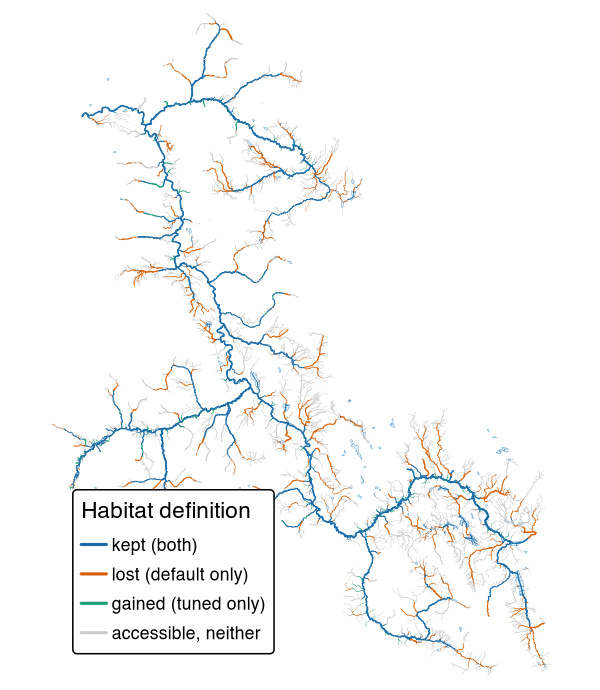

# knowledge 

<!-- badges: start -->
[](https://lifecycle.r-lib.org/articles/stages.html#experimental)
<!-- badges: end -->

> Tests fish habitat definitions against what is known about where fish live, and tunes them from the fish records

knowledge starts from what is known about each species' life history in British Columbia's streams, from the
published literature and past reports, and tests it against the Province's fish sampling records: where sampling
caught the species and where it did not. The biology sets the shape of a fish habitat definition, such as young
chinook rearing in small streams close to a large river. Where the records allow, they tune its values, such as the
smallest stream and the steepest gradient, and each is checked on parts of the province it was not chosen from. The
habitat definitions are the ones [link](https://www.newgraphenvironment.com/link/)'s habitat models use to map where a
species can spawn and rear, and knowledge compares each tuned one with the one link uses today. A habitat map steers
where conservation and restoration effort goes, and one built this way rests on where fish have been found.



*Chinook rearing habitat in the Bulkley River watershed group, around Smithers and Houston, under link's
`default` habitat definition and the one tuned here. Blue streams are habitat under both, orange only under
`default`, green only under the tuned one; grey streams are open to chinook but habitat under neither. Here the
tuned habitat definition drops more than it adds.*

## Installation

```r
pak::pak("NewGraphEnvironment/knowledge")
```

knowledge is under active development and its functions change between releases (see
[NEWS](https://www.newgraphenvironment.com/knowledge/news/index.html)). Pin a release for
reproducible work: `pak::pak("NewGraphEnvironment/knowledge@vX.Y.Z")`.

The evidence tables live in the repository, not the package, so most work happens in a clone with the
package loaded from the source tree (`pkgload::load_all()`). The scripts that build them run in the order
of [`scripts/README.md`](https://github.com/NewGraphEnvironment/knowledge/blob/main/scripts/README.md).
Many read a PostgreSQL database holding the BC Freshwater Atlas through fwapg, found by the standard `PG*`
environment variables, and the tuning also reads link's province-wide run and wet's flows there. Others need
other databases, tools and credentials, among them a bcfishpass database, a synced Zotero library and Web API
key, Ollama, AWS credentials and Python.

The FDIS electrofishing extract is public as the Province supplied it, under `s3://fresh-bc/fdis/`, and so
are the visit tables built from it, as Parquet under `s3://fresh-bc/knowledge/fdis/`. The bucket does not
list: start from the extract's [provenance note](https://fresh-bc.s3.us-west-2.amazonaws.com/fdis/README.md),
which links the published tables' manifest.

## Example

The tuned thresholds are one table. Each habitat definition's parts are rows, with the link parameter each fills where
link has one:

```r
th <- read.csv("data/thresholds.csv")
ch <- th[th$rule_id == "CH_rear_v1", c("component", "link_parameter", "value", "unit")]
print(ch, row.names = FALSE)
#>    component           link_parameter   value     unit
#>         size             rear_mad_min    0.75     m3/s
#>     gradient        rear_gradient_max    0.13 fraction
#>  exception_q rear_river_discharge_min    3.00     m3/s
#>  exception_d  rear_river_distance_max 1000.00        m
```

On a stream line, the tuned habitat definition passes a segment for chinook rearing where its gradient is at most 13 % and
either its mean annual flow is at least 0.75 m³/s or a river of at least 3 m³/s lies within 1 km downstream.
Access and link's other steps then apply as they do to `default`.

## Learn more

- [Tuning fish habitat definitions with fish sampling records](https://www.newgraphenvironment.com/knowledge/articles/tuning-method.html):
  the method every species' habitat definition is tuned by, and its limits.
- [Tuning habitat: chinook rearing](https://www.newgraphenvironment.com/knowledge/articles/tuning-chinook-rearing.html):
  the answer and the map first, why a nearby river matters, how sure we are, and how it was done.
- [Splitting streams at fish records shifts the steepest slope mapped as habitat](https://www.newgraphenvironment.com/knowledge/articles/tuning-stream-splits.html):
  how where link cuts a stream changes the slope limit the records choose.
- [What is known](https://github.com/NewGraphEnvironment/knowledge/blob/main/research/README.md): one file per topic, from the FDIS export and the cited literature
  to the tuned habitat definitions.
- [Function reference](https://www.newgraphenvironment.com/knowledge/reference/index.html)

## Ecosystem

| Package | Role |
|---|---|
| **knowledge** | Tests fish habitat definitions against what is known about where fish live, and tunes them from the fish records (this package) |
| [fresh](https://www.newgraphenvironment.com/fresh/) | Stream network modelling engine: segment, classify, cluster, aggregate |
| [link](https://www.newgraphenvironment.com/link/) | Intrinsic habitat models: develop, test and communicate |
| [wet](https://www.newgraphenvironment.com/wet/) | Stream flow and water temperature for BC's Freshwater Atlas |
| [flooded](https://www.newgraphenvironment.com/flooded/) | Delineate floodplain extents from DEMs and stream networks |
| [drift](https://www.newgraphenvironment.com/drift/) | Track land cover change within floodplains over time |
| [floodplains](https://www.newgraphenvironment.com/floodplains/) | Floodplain and land cover change modelling for BC watershed groups |
| [stac_floodplains_bc](https://www.newgraphenvironment.com/stac_floodplains_bc/) | STAC catalogue of floodplain land cover change in BC, 2017-2023, by watershed group |
| [cd](https://www.newgraphenvironment.com/cd/) | Climate departure analysis from ERA5-Land reanalysis |
| [fly](https://www.newgraphenvironment.com/fly/) | Estimate airphoto footprints and select photos that cover a study area |

## Data and methods it builds on

Fish records come from the Province of British Columbia: the Fisheries Data Information System (FDIS)
electrofishing extract it supplied, [Known BC Fish Observations](https://catalogue.data.gov.bc.ca/dataset/known-bc-fish-observations-and-bc-fish-distributions),
and the fish data submissions filed in [EcoCat](https://a100.gov.bc.ca/pub/acat/), which also holds the past
reports. Stream crossings come from [PSCIS](https://catalogue.data.gov.bc.ca/dataset/pscis-assessments). The
FDIS visits are placed on the stream segments of link's province-wide run, built on the
[BC Freshwater Atlas](https://www2.gov.bc.ca/gov/content/data/geographic-data-services/topographic-data/freshwater)
through [fwapg](https://smnorris.github.io/fwapg/), with flows from [wet](https://www.newgraphenvironment.com/wet/)
and dams from the [Canadian Aquatic Barriers Database](https://aquaticbarriers.ca/), and each visit is matched
to the records it produced in [bcfishobs](https://github.com/smnorris/bcfishobs). The floodplain panels of the
comparison maps in `research/fig/`, and the floodplain areas in `data/compare/floodplain.csv`, come from
[stac_floodplains_bc](https://www.newgraphenvironment.com/stac_floodplains_bc/). Some crossing and report scripts
also read a [bcfishpass](https://smnorris.github.io/bcfishpass/) database. fwapg, bcfishobs and bcfishpass are Simon
Norris's (Hillcrest Geographics), bcfishpass maintained with contributions from many groups. Each value taken from the
literature carries a verbatim quote, checked against its source.

## Citation

```r
citation("knowledge")
```

## License

MIT for the code (see [`LICENSE`](https://github.com/NewGraphEnvironment/knowledge/blob/main/LICENSE)). Data from other sources carries its own terms: see
[`NOTICE.md`](https://github.com/NewGraphEnvironment/knowledge/blob/main/inst/NOTICE.md).
