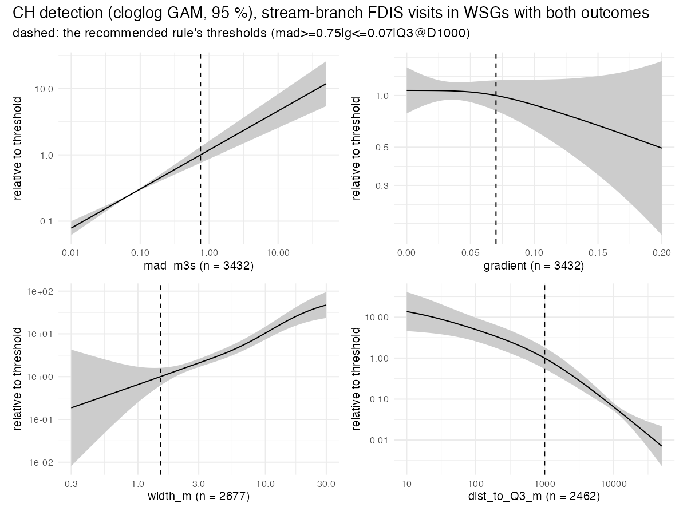
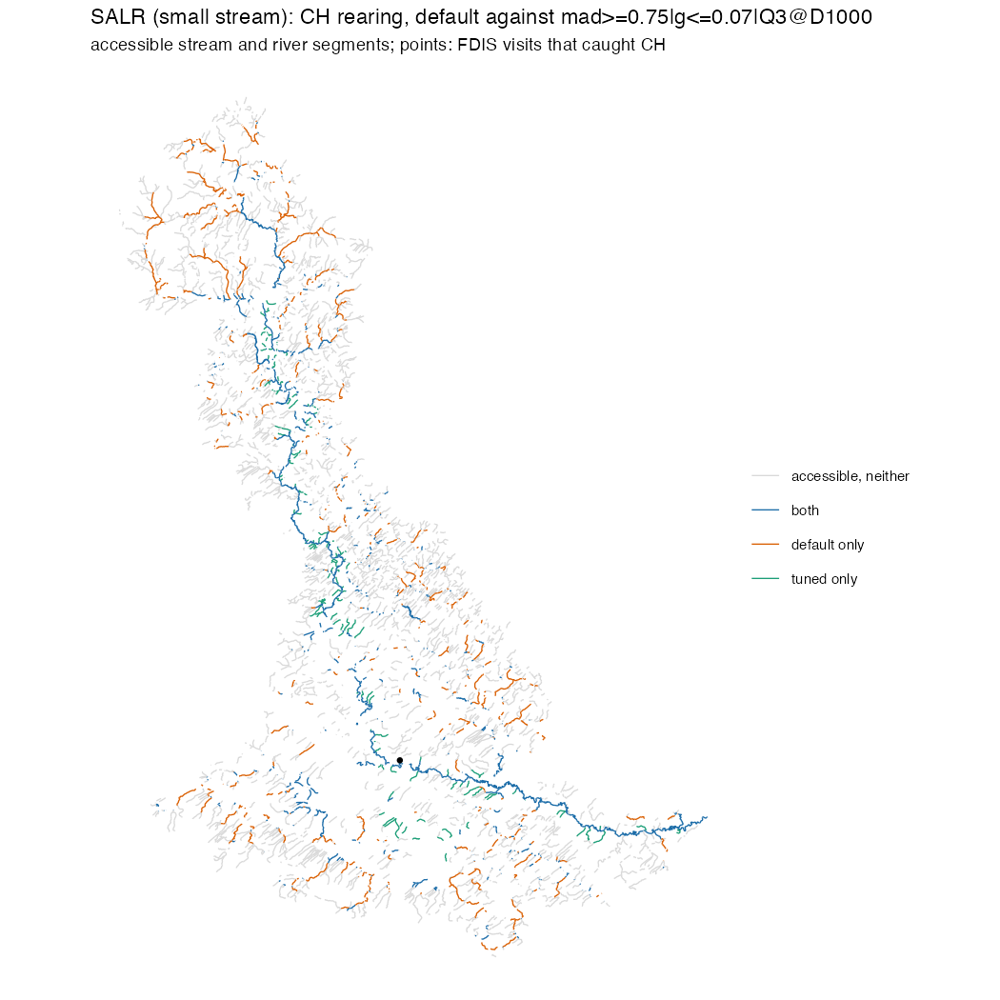
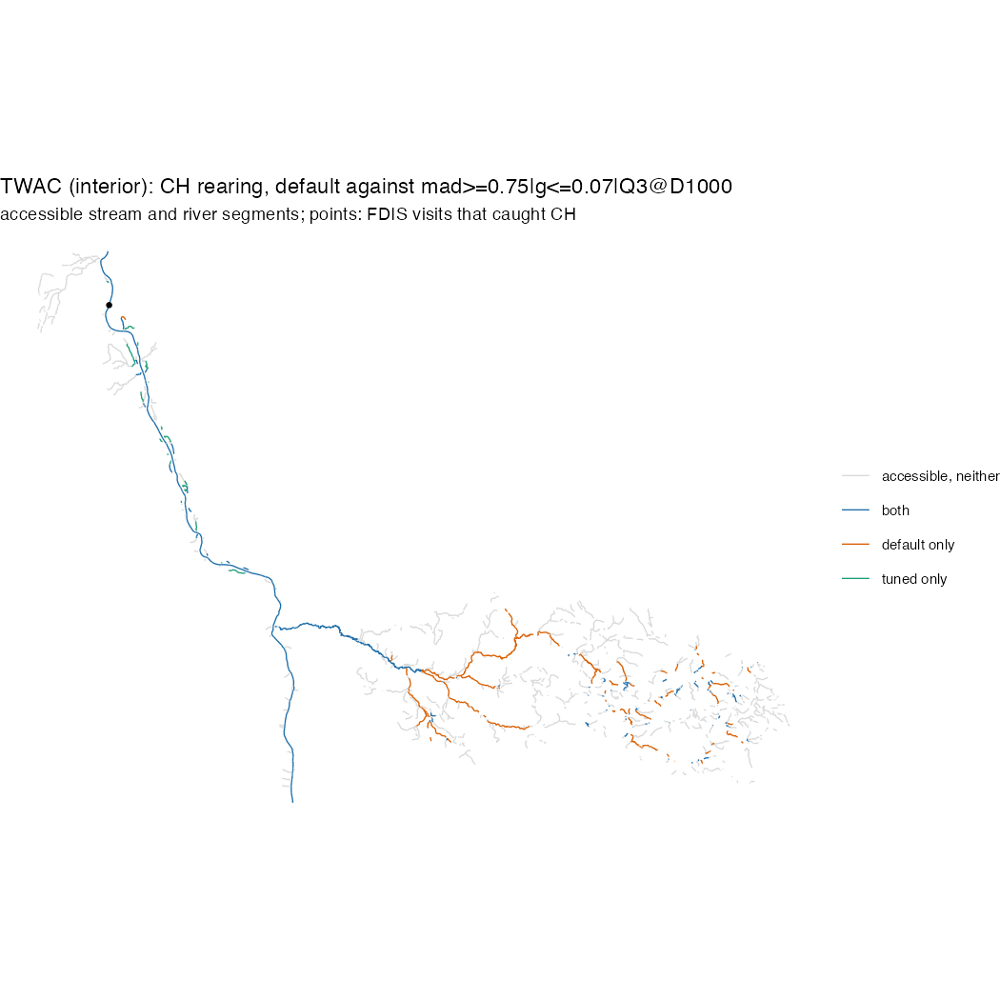
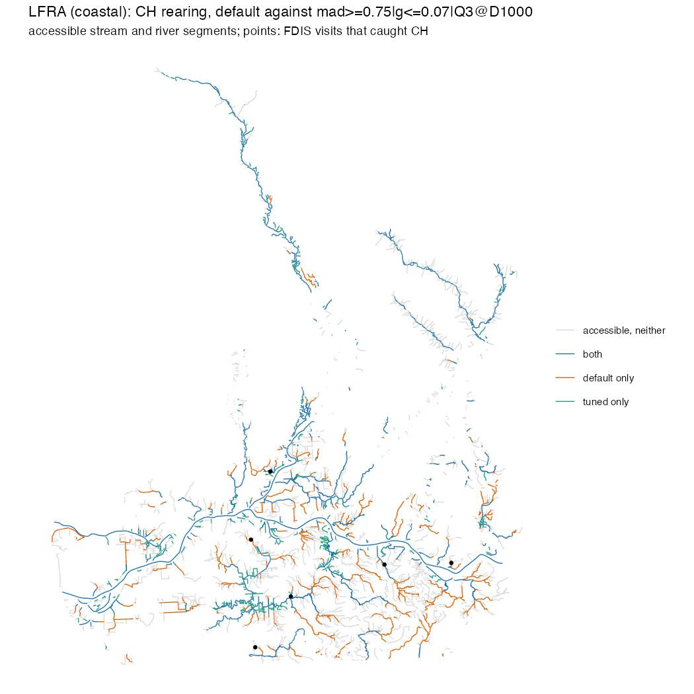

# A tuned Chinook rearing rule: stream size, gradient and distance to a river, beside link's `default`

**Verified:** 2026-10-23 (retuned province-wide on the evidence rebuilt on wet's 2026-10-19 flows, with the walk ending
at the river's bank, the gradient ladder to 30 % for every species and the pick read from link's flow start, #73; the
earlier states: #54's 55-group build 2026-10-16, rerun without repeated surveys 2026-10-17 (#35); the province-wide
rescoring 2026-10-17 (#57); the ladder above 9 % 2026-10-19 (#67); the grade and comparison 2026-10-19 (#65); the picks at
1.96 SE 2026-10-20 (#79)) · **Issues:** #54 (this file's first build), #57, #65, #67, #68, #73, #79, #80; builds on #52
(`chinook_stream_size.md`), which picked 0.5 m³/s, 10 m³/s and 500 m by hand; uses wet's flow (`modelled_discharge.md`)
and the FDIS export (`fdis_export.md`); link reads the result through NewGraphEnvironment/link#346 · **Produced by:**
`scripts/0310` (evidence build, ledger `scripts/logs/habitat/20261022_evidence_build_ledger.csv`), `scripts/0320`
(`data/tune/CH_rear_*`, log `scripts/logs/habitat/20261022_tune_run-ch_co.txt`), `scripts/0330` (`data/compare/CH_rear_*`,
log `scripts/logs/habitat/20261022_compare.txt`), `scripts/0325` (`data/thresholds.csv` row `CH_rear_v1`; the grade table
`knowledge/habitat_grade/v1`); #54's own scripts are named under "The #54 record" · **Status:** measured; nothing applied
in link. The method and the cross-species table are `habitat_thresholds_tuned.md`; the plain-language account is the
package article (last section).

## What to expect of juvenile chinook

Chinook fry and parr rear in larger streams than coho do, and in small streams mostly where those are tributaries of a
river that holds chinook. The intrinsic-potential models set the floor well above zero: Agrawal's juvenile model, as
Sheer et al. (2009) summarise it, at a mean annual discharge of 0.28 m³/s (`data/literature_evidence.csv` row 120), Woll
(2015) at 0.5 m³/s, below which a stream has no potential (row 412), Cooney and Holzer (2006) at a bankfull width of
3.7 m (row 403); Partridge and Platts (1978) found the Salmon River's juveniles in tributaries averaging over 5.5 m
wide, 71 % of them in reaches over 9.1 m (rows 52–53), while Porter et al. (2008), from FDIS catch in the Thompson, put
the smallest streams above 3.25 % in the top class and so imply no minimum (rows 43, 470). The small streams that do
count are the lower reaches of non-natal tributaries to large rivers: Kirsch et al. (2014) and Buckwalter and Kirsch
(2012) look for rearing there at 0.5–1.5 % (rows 48–49), Gregersen (2019) finds it on non-natal streams under 2 %, to
3.5 % (rows 46–47), and Beamer et al. (2013) found none in small non-natal channels steeper than 6.5 % (row 45). The
gradient limits the models carry run from Agrawal's 8 % with very low potential above 3.5 % (row 57) through Woll et
al.'s (2017) 7 % (row 37) to Partridge and Platts' 10 % (row 50). The expectation is therefore a size floor near 0.3–0.5
m³/s or several metres of width, an allowance for the small streams close to a river, and a gradient limit somewhere
between 3.5 and 10 %, against link's `default` of width ≥ 1.5 m, gradient ≤ 5.49 % and no allowance.

## Evidence

7,123 stream-branch electrofishing visits (216 with CH) in 104 groups in link's CH range with no natural barrier
downstream; 4,490 of them, in the 43 groups where chinook were both caught and missed, are modelled. Chinook were caught
on 5.6 % of the 3,066 modelled visits at 5.49 % or less, 3.3 % at 5.49–7 %, 2.5 % at 7–9 %, 4.2 % at 9–11 %, 2.4 % at
11–13 %, 8.9 % of the 56 visits at 13–15 % and 0.8 % of the 236 above 15 %; none of the modelled visits is above 20 %.
Of the 3,792 visits on streams under 0.75 m³/s, the 672 within 1 km of a ≥ 3 m³/s river hold 91 of the 123 detections
(13.5 % against 1.0 %), and 211 visits at a distance of 0, the visit lying on the river's own line, hold 46.

## Recommended rule: gradient ≤ 13 %, and either MAD ≥ 0.75 m³/s or a ≥ 3 m³/s river within 1 km

It is the best rule of the grid (held-out deviance 1,120.5 against 1,382.5 for no rule) and the pick from `default`'s
width start, three departures from `default` (the size test moves from width to flow, the gradient from 5.49 to 13 %,
and the exception is added). The region holds 83 rules, every one a MAD rule with the exception: MAD 0.15–1 m³/s,
gradient 7–30 %, Q 1–10 m³/s, D 500–2,000 m. Chinook are caught on 14.6 % of the 1,234 visits the rule admits
(180 of the 215 detections) against 1.1 % outside; `default` admits 2,330 with 165 detections, 7.1 % against 2.3 %.
About half of what the rule admits comes through each gate: on the curve's 4,487 visits, 675 pass the floor (89 CH) and
557 the exception alone (90 CH).

**`default` is outside the region**, 226.4 behind the best (SE 91.8, 2.47 SEs), on all four extra fold seeds; so is
link's `default_tuned` floor at `default`'s gradient (MAD ≥ 0.28 m³/s, 5.49 %, no exception; link#331), 188.9 behind
(SE 81.2). No rule without the exception is in the region (the best, MAD ≥ 0.2 at 11 %, is 150.5 behind, SE 77.8), and no
width rule is (the best, width ≥ 4 m at 15 % with the exception, 66.4 behind, SE 40.5).

**From link's flow start** (#80; `default_tuned`'s MAD ≥ 0.28 m³/s at 5.49 %), the fewest-departures region rule is
**MAD ≥ 0.28 m³/s, gradient ≤ 11 %, a ≥ 3 m³/s river within 1 km** (two departures: the gradient and the exception),
26.3 behind the best (SE 28.8), admitting 1,502 visits with 187 detections (12.5 % against 0.9 %). The two starts agree
on the exception and disagree on how far the floor moves off 0.28: from the width start the size profile prefers 0.75
(1 m³/s +1.8, 0.5 +4.4, 0.28 +25.7, SE 24.4), from the flow start the parsimony rule keeps 0.28 because it is within the SE.

**At 1.96 SE** (#79) the pick from the width start is MAD ≥ 1 m³/s at `default`'s 5.49 % with the exception, from the
flow start MAD ≥ 0.28 at 5.49 % with the exception, from a region of 2,066 rules; `default` is 2.47 SEs behind and stays
outside. The exception is the one component the stricter bar keeps from both starts.

**What the checks say** (each listed with its direction):
- *Nested selection* (the pick chosen on four folds, scored on the fifth): 1,183.4 against `default`'s 1,347.0 and
  1,382.5 for no rule. The folds pick MAD ≥ 1 at 11 % with Q3 within 1 km (twice), MAD ≥ 0.75 at 11 %, MAD ≥ 0.5 at 13 %
  with Q3 within 1 km and MAD ≥ 0.5 at 13 % with Q10 within 1 km, and beat `default` on four of the five folds (fold 4:
  243.4 against 230.3). For the rule family; no fold picks the exact rule.
- *Four more fold seeds*: none recommends the exact rule; all four recommend a MAD floor of 0.5 or 0.75 m³/s with a
  ≥ 3 m³/s river within 1 km at 11, 13 or 15 %; `default` outside the region on all four; the main pick inside each
  seed's region. For the shape, not the exact values.
- *Group bootstrap* (200 resamples, width start | flow start): a MAD floor in 100 | 100 %; 0.75 in 28.5 | 18.5 %, 0.5
  24.5 | 18.5, 1 23.5 | 18.5, 0.28 2.0 | 37.0; gradient 11 % in 26.0 | 26.5 %, 15 % 24.0 | 27.5, 30 % 18.5 | 16.5, 5.49 %
  15.0 | 10.5, 13 % 14.0 | 16.0; Q 3 m³/s in 68.5 | 62.5 %, 1 m³/s 21.0 | 26.5; D 1 km in 71.0 | 71.5 %, 2 km 21.5 | 19.0.
  The exact rule in 5.5 %. For flow over width and for a ≥ 3 m³/s river within 1 km; the floor's value and the gradient
  are each spread over three or four values.
- *Profiles* (best rule at each value, as deviance behind the best, SE): size 0.75 best, 1 +1.8 (18.2), 0.5 +4.4 (20.6),
  0.2 +19.5, 0.35 +21.0, 0.28 +25.7 (24.4), 0.15 +34.7, 0.1 +52.9 (50.6), width 4 m +66.4 (40.5) to 1 m +199.0; gradient
  13 % best, 11 % +0.4 (12.9), 15 % +2.3 (6.0), 20 % +7.3 (7.7), 30 % +7.3 (11.9), 25 % +11.4, 9 % +17.5 (17.3), 7 % +21.6
  (29.9), 5.49 % +63.6 (46.1), 4 % +105.4, 3 % +149.6; Q 3 best, 1 +11.5 (24.7), 5 +20.9, 10 +26.6, 20 +54.1, none +150.5
  (77.8); D 1,000 m best, 2,000 +16.3 (23.5), 500 +35.4, 5,000 +51.2, 250 +54.3, 100 +85.5. For flow over width, for the
  exception at 1–10 m³/s within 1–2 km, and for a gradient maximum of 7 % or more; flat from 11 to 30 %.
- *The joint curve* (log size × log distance to a 3 m³/s river, gradient; edf 12.1, 1.0, group effect 33.6) scores
  1,053.2 held-out, below the grid's best: the surface carries more than the cut. Detection rises log-linearly in size
  (relative to the rate at 0.75 m³/s: 0.52 at 0.28, 2.2 at 3, 4.0 at 10 m³/s), peaks about 110 m from a 3 m³/s river at
  2.3 times the rate at 1 km and falls to 0.52 at 2 km, 0.37 at 3 km and 0.29 at 5 km, and falls linearly in gradient
  on the link scale (2.1 at 5.5 %, 1.0 at 13 %, 0.82 at 15 %, 0.49 at 20 %). For the three components as slopes: each
  threshold is the cut that best separates held-out detection, and only the distance curve bends, inside the 1 km.

## What it is not

- **Not a 13 % limit on where chinook rear.** The gradient maximum rests on 633 modelled visits above 9 % with 19
  chinook, 292 above 13 % with 7 and 236 above 15 % with 2, and the ladder is flat from 11 to 30 % (every maximum
  within 7.3 of the best, each within its SE). The records exclude 5.49 % and below from the region and cannot place the
  maximum between 7 and 30 %; 13 % is the pick because it scored best, as 15 % did on #67's ladder and on the first
  scoring of this evidence (below). Beamer's 6.5 % and Partridge and Platts' 10 % sit inside that range; Agrawal's
  3.5 % and Woll's 7 % at or below its bottom.
- **Not a bend in size or distance.** Size and gradient are slopes; the distance curve peaks about 110 m from the river
  and the 1 km cut sits on its fall.
- **Not a new family.** `CH_rear_v1` as published (MAD ≥ 0.75, 9 %, Q3 within 1 km) is 17.5 behind the best with an SE
  of 17.3, a hair outside the region, while MAD ≥ 0.5 and MAD ≥ 1 at 9 % with the same exception are inside it; the
  first scoring of this evidence, before the intercept fit was corrected (below), picked MAD ≥ 0.5 at 15 % with a
  1 m³/s river within 1 km, 11.5 behind (SE 24.7) and inside. The retune moves the pick within the family the records
  support, not out of it.
- **Not a rule for river polygons, wetlands or lakes**, which keep `default`'s tests under every rule; on link's
  segments the gradient maximum also reaches river polygons, and the scoring did not see them.
- **A rate per standard electrofishing visit, not capacity or density.**

## The gradient ladder above 9 % (#67, folded in by #68)

`CH_rear_v1` took 9 %, the top of #57's shared ladder, so #67 scored CH rearing again on the same evidence with the
ladder extended to 11, 13, 15, 20, 25 and 30 % (`scripts/0322`; `data/tune/grad_ext/`, logs
`scripts/logs/habitat/20261018_tune_grad_extend*.txt`, `20261019_…-compare.txt`): the best moved to 15 % with a 1 m³/s
river within 1 km, every maximum from 7 to 30 % had rules in the region, the four seeds all picked 15 %, nested
selection swung between 11, 15 and 30 % and lost to `default` overall (1,389.4 against 1,347.0) while beating it on
the three folds that chose 15 %, and on link's segments a steeper limit added 1,680–3,070 km, half of it small streams
the exception admits and a third connectivity (`data/compare/grad_ext/CH_rear_beside_v1.csv`). `CH_rear_v1` kept 9 %
because the ladder was fixed before the run and every species is tuned on one ladder; extending it for every species
was #68, done here. On the rebuilt evidence the best rule at each maximum, as deviance behind the best (SE), the rules
in the region there, and the share of bootstrap resamples recommending that maximum (width start | flow start):

| Gradient max | Best rule there | Behind the best | Region rules | Bootstrap, width start | flow start |
|---|---|---|---|---|---|
| 3 % | MAD ≥ 0.5, Q10 within 500 m | 149.6 (74.4) | 0 | 0 | 0 % |
| 4 % | MAD ≥ 0.5, Q10 within 1 km | 105.4 (59.9) | 0 | 0 | 0.5 % |
| 5.49 % (`default`) | MAD ≥ 1, Q3 within 1 km | 63.6 (46.1) | 0 | 15.0 | 10.5 % |
| 7 % | MAD ≥ 1, Q3 within 1 km | 21.6 (29.9) | 3 | 2.5 | 2.5 % |
| 9 % (`CH_rear_v1`) | MAD ≥ 0.75, Q3 within 1 km | 17.5 (17.3) | 2 | 0 | 0 % |
| 11 % | MAD ≥ 0.75, Q3 within 1 km | 0.4 (12.9) | 13 | 26.0 | 26.5 % |
| 13 % (the pick) | MAD ≥ 0.75, Q3 within 1 km | 0 | 10 | 14.0 | 16.0 % |
| 15 % | MAD ≥ 0.75, Q3 within 1 km | 2.3 (6.0) | 25 | 24.0 | 27.5 % |
| 20 % | MAD ≥ 0.75, Q3 within 1 km | 7.3 (7.7) | 13 | 0 | 0 % |
| 25 % | MAD ≥ 0.75, Q3 within 1 km | 11.4 (8.0) | 5 | 0 | 0 % |
| 30 % | MAD ≥ 0.75, Q3 within 1 km | 7.3 (11.9) | 12 | 18.5 | 16.5 % |

The same shape at every maximum from 7 % up, and the same reading as #67's: the maximum sits at 7 % or above and the
records cannot place it between 11 and 30 %.

## The intercept fit, and the first scoring of this evidence

The held-out score refits each held-out group's intercept with the fold's predictions as an offset. On this evidence
`stats::glm.fit()` reported convergence at an intercept that put every detection of seven groups under its
probability clamp (55.3 deviance per detection: 28 detections in seven groups, 1,547 of the curve's 2,434), and the
same happened to 2,269 of the 6,149 rules wherever a rule's fold pinned a group. `.tune_group_dev()` now minimises the
deviance in the intercept directly (bounded golden section; the deviance is convex in the intercept under cloglog);
the 3,880 rules no fold pinned score identically, CO's tables are unchanged, and the first scoring's pick, MAD ≥ 0.5 at
15 % with a 1 m³/s river within 1 km, keeps its score (1,132.1) and its place in the region while the rules the fit had
inflated, this file's pick among them (1,305.6 → 1,120.5), move below it (`planning/active/findings.md` for #73, the
run's two logs).

## Grade (`knowledge/habitat_grade/v1`; `scripts/0320`, 2026-10-23)

Every accessible segment of the 125 groups is walked from its downstream end to the first ≥ 3 m³/s river, ending at a
double-line river's bank (#73; the connector inside the river's polygon and the jump to its centreline left out), and
read on the flows wet republished on 2026-10-19 (the table records the load). 5.76 M segments, 856,244 accessible,
852,431 graded (6,259 with no flow even from a parent); 809,410 walks found a river (9,159 of them in another watershed
group) and 46,833 reached the sea or the cap first. Reference rate 0.136 over edge types 1000, 1100, 2000 and 2300. Of
225,152 accessible km, 224,459 are graded and sum to 61,423 grade-weighted km (#65: 63,059, to the centreline at 9 %):
68 % of graded km lies under 0.2, 21 % at 0.8–1. 51,257 km read a distance of 0, 33,350 of them river-polygon lines
(31,522 of the 43,497 graded river-polygon km grade 0.8 or more, against 9,664 of the stream branch's 147,668), where
the curve is an extrapolation (`habitat_thresholds_tuned.md`, Limits).

## What the rule changes on link's segments (`scripts/0330`, `data/compare/CH_rear_*`)

The baseline is link 0.67.0's `default` (configs at `67a410e2`, origin/main on 2026-10-22), regenerated through fresh's
predicate, the user-habitat overlay and connectivity on link's 125 CH groups: width ≥ 1.5 m and gradient ≤ 5.49 %, and on
through-wetland lines (edge 1050/1150) that door plus `default`'s own pair, a ≥ 15 m or ≥ 3 m³/s river within 1,000 m
(link#364). It draws 99,186 km where the stored flags, from the run's older configs, hold 101,229 (the two differ on
2,942 km; the access gate alone moves 2,607). The tuned rule is set beside it under the three structures the plan named,
because its exception can be scoped two ways:

| structure | tuned km | change | lost | gained | of the gain, by the exception | graded km, `default` → tuned |
|---|---|---|---|---|---|---|
| free pass on through-wetland lines, pair on every stream line (as the rule was scored) | 92,041 | −7.2 % | 24,818 | 17,673 | 12,840 | 48,091 → 54,134 |
| door on through-wetland lines, pair on every line (link's `both`) | 84,294 | −15.0 % | 30,477 | 15,585 | 12,949 | 48,091 → 53,911 |
| door, pair on through-wetland lines only (link's `wetland_flow`, `default`'s scope for CH) | 66,832 | −32.6 % | 35,067 | 2,713 | 84 | 48,091 → 44,943 |

Under the door with the pair on every line, 24,250 km are lost where a stream over 1.5 m wide carries under 0.75 m³/s
with no ≥ 3 m³/s river within 1 km, 6,127 km of through-wetland lines pass `default`'s door and fail the tuned one, and
100 km go to connectivity; 12,221 km are gained by the exception, 1,821 km at gradients between 5.49 and 13 %, 756 km
through connectivity and the overlay, 452 km where the flow passes and the width fails or is unmeasured, and 56 km of
through-wetland lines. 8,931 of the 15,585 km gained are order-1 streams. Graded km rises while km falls, as it did
in #65: the rule trades small low-grade streams for the near-river exception. The third structure differs from the
second in one thing, where the pair applies, so the 17,462 km between them is the pair's whole reach on stream lines:
12,137 km it admits and 4,569 km `default` draws on width that only the pair keeps, the rest connectivity. Across
groups (door, pair on every line) the change runs from −76.0 % (UDEN, −1,278 km) to +35.4 %, median −3.2 %; 51 of 125
groups gain. The largest losses are UDEN, GRAI (−1,087 km), UCHR (−1,054), NECR (−883) and NARC (−809); the largest
gains LSKE (+240), UFRA (+225) and TATR (+184).

**Checks, each with its direction.** FDIS detection on each rule's segments against accessible segments outside it:
`default` 13.6 % against 2.2 % (773 of 5,673 visits, 107 of 4,842); free 16.0 % against 1.3 %; door with the pair on
every line 16.7 % against 1.3 % (805 of 4,818, 75 of 5,697); door with the pair on through-wetland lines only 18.6 %
against 2.5 % (715 of 3,844, 165 of 6,671). On the bcfishobs records FDIS does not hold (presence only, never scored),
the share of locations on the rule's segments over the rule's share of accessible stream-edge km is 2.46 (2.37–2.54)
for `default` on 32.8 % of the km, 3.11 (3.01–3.20) for the free pass and 3.11 (3.01–3.20) for the door on 26.6 %, and
4.33 (4.09–4.54) for the pair on through-wetland lines only, on 14.9 %. The lift over `default` is 0.65 (0.54–0.77)
for the door and 1.86 (1.62–2.06) for the narrow scope. So: the inside rate and the concentration of records favour
the narrow scope, which draws 15 % of the km; the outside rate favours the pair on every line, because the narrow
scope leaves 165 detections on accessible segments outside the rule where the door leaves 75. The first two structures
cannot be told apart by either check.

**Structure: the door, with the pair on every line** (link's `both`), and this is a decision made before the run,
not one the checks made: the rule was scored on stream-branch visits with the exception in force (557 of the visits it
admits pass only through the exception, 90 of them with chinook, 16 %), so publishing it with the pair scoped to
through-wetland lines would publish a rule the evidence never saw. link#364 scoped `default`'s CH pair to
`wetland_flow` after measuring `both` on five held-out groups (275.6 km added at 5 % of the core rate); that was
`default`'s 15 m or 3 m³/s pair beside its 1.5 m width floor, and this is a 3 m³/s pair beside a 0.75 m³/s floor on
104 groups' visits, so the two measurements do not contradict each other and link#346 chooses with both in hand. The
thresholds table publishes the pair as discharge (`rear_river_discharge_min = 3`, `rear_river_distance_max = 1000`,
`rear_river_measure = discharge`) and, from `0325`'s next run (Phase 8), the scope as `near_river_scope = both`; the
column is not in the table yet.

**Through-wetland lines.** On link#364's five groups (ADMS, BULK, CHWK, CLWR, SQAM) `default` keeps 212.7 km of CH
rearing on edge 1050/1150 after connectivity, the free pass 234.8, the door 61.7 and the narrow scope 59.0; over all
125 groups 8,422, 10,257, 2,495 and 2,329 km. link#364 measured its door alone removing 43.1 km from `default` on
those five groups; the tuned door removes about 150 km more there because its size test on a wetland line is the
stricter one (0.75 m³/s or a river within 1 km, against 1.5 m wide or the 15 m/3 m³/s pair), while its gradient
limit is the laxer.

The floodplain table (`data/compare/floodplain.csv`) and the maps were not redrawn for #73 (`0330 STAGE=maps`); their
chinook figures are #65's, on the run's own configs. The GeoPackage `data/compare/gpkg/CH_rear.gpkg` (ignored) carries
every segment's verdict under each rule and structure. Maps: `research/fig/compare_ch_rear_*.png`.

## The #54 record: the 55-group build

The sections below are #54's analysis on link's 55-group build of 2026-10-15 (3,433 modelled visits with 166 CH in 26
groups; `scripts/0296-ch-rule-build.R` with `scripts/sql/ch_dist_profile.sql`, `scripts/0297-ch-rule-tune.R`,
`scripts/0298-ch-rule-compare.R`; `data/ch_rule_{tune,curves,flips,compare,checks,change}.csv`; the figures in `fig/`;
logs `scripts/logs/habitat/20261015_ch_rule_*`, `20261017_ch_rule_tune.txt`; the plan review in
`planning/archive/2026-10-issue-54-chinook-rearing-tuned/review-plan.md`). They are kept as the specification of the
method, the readings and the sensitivities, which the province-wide run reuses; where a number below differs from the
figures above (#54 recommended 7 % on a ladder to 9 %, and its side by side covers 31 groups), the figures above stand.

Every figure names its population. Three recur:
- **Tuning population.** FDIS electrofishing visits on link's CH stream branch, with no natural CH barrier downstream:
  4,516 visits (166 CH) in 45 WSGs. The models use the 26 WSGs where CH were both caught and missed: 3,433 visits,
  166 CH.
- **All stream-branch visits**, barrier status unknown or blocked kept: 15,186 visits (264 CH); 9,745 visits
  (263 CH) in 46 WSGs modelled.
- **Side-by-side groups.** The 31 WSGs where link's `fresh_default` classified CH: 53,653 km of accessible stream
  edges.

## The question

#52 found CH rarely caught in streams under about 0.5 m³/s unless a ≥ 10 m³/s river is within 500 m downstream.
Those three numbers were picked by hand. Which rearing rule do the visits support, and how far can each value move
before the data can tell the difference?

The rule tuned here is link's `default` CH rearing rule with three things open:
- the stream size test (a MAD floor or a channel-width floor);
- the gradient maximum;
- an exception for small streams within D m downstream of a river of at least Q m³/s.

Nothing else in `default` changes. River polygons keep their size test (any non-NULL width) under every rule. In
this comparison their gradient maximum moves with the stream branch's. In the configuration the link draft proposes,
those are three settings (each of the two stream rules' own gradient, and the CSV's `rear_gradient_max`, which the
river rule inherits), and they must be moved together. Wetlands, lakes, access, the user-habitat overlay and the cluster pass that keeps only rearing connected to spawning are unchanged.

## Short answer

1. **The visits support a different rule from `default`, in all three components.** Recommended, by the rule fixed
   before the run (the main reading's pick): **gradient ≤ 7 %, and either MAD ≥ 0.75 m³/s or a ≥ 3 m³/s river within 1,000 m downstream**. Ranges within one SE of the best on the main reading
   (a rule of thumb fixed before the run, not a boundary of noise; "Method"):
   - MAD floor 0.28–1 m³/s, with 0.5–0.75 in 86 % of bootstrap resamples;
   - gradient 7–9 %, the best rule's 7 or 9 % in all 15 readings (5.49 % is recommended in 23.5 % of bootstrap
     resamples and on one of four extra fold seeds, and is in the region of only two of the 15 readings: FWA gradients
     for link-placed visits, and fwapg's old MAD);
   - river size Q 1–10 m³/s, mostly 3;
   - distance D 1–2 km.

   `default` (width ≥ 1.5 m, ≤ 5.49 %) is outside the region in all 15 readings: on the main one, 188 deviance above
   the best (SE 79) on held-out groups. So is `default`'s MAD form (0.28 m³/s, 5.49 %, no exception), at 131 (SE 59).
   No rule without the exception is in any reading's region. On the main reading no width rule is either; one
   reading (link-placed visits on FWA gradients) has 2 width rules among the 87 in its region.

   **Two rules are inside the region of all 15 readings:** MAD ≥ 0.5 m³/s, Q 3 m³/s within 1,000 m, at a gradient of
   7 % or 9 %. On the main reading they are 4.1 (SE 17.0) and 2.8 (SE 18.2) above the best. The recommended rule is
   inside 13 regions. It is outside the region of both readings on the visits placed on link's segments (2,825
   modelled visits in 16 WSGs). There, on link's segment gradient MAD ≥ 0.75 is in the region only at 9 %, and on the
   FWA gradient only at 5.49 % and 7 %.
2. **The tuned rule is narrower than `default`, not wider.** On the 3,433 modelled visits it admits 730 against
   1,788 and takes in 128 CH against 130 (raw rates 17.5 % against 7.3 %). On link's segments in the 31 groups,
   CH rearing falls from 31,948 to 26,092 km (−18 %).
   - 8,756 km are lost. 8,660 km of that is streams that pass the 1.5 m width but carry under 0.75 m³/s with no
     ≥ 3 m³/s river within 1 km, and 98 % is on order 2 and above.
   - 2,900 km are gained. 2,471 km of that comes through the exception. 69 % of the gain (77 % of the exception's)
     is on order-1 streams, which `default`'s stream branch never admits unmeasured.
3. **Neither size nor distance has a threshold in the data.** Detection rises log-linearly with MAD and steadily
   with width, and falls steadily with distance. Each value is the cut that best separates held-out detection, not a
   bend in a curve.
4. **The flow model moves the floor between 0.5 and 0.75 m³/s** (the best rule on routed flow alone has 0.5, on the
   balance alone 0.75, on fwapg's old MAD 0.5). It does not move the exception or the conclusion about `default`.
5. **`default`'s MAD bounds, if a group were moved to `mad`, would drop large rivers.** Under fresh's `mad` model the
   river-polygon branch takes the 0.28–100 m³/s range. On link's segments, 441 of the 699 FDIS CH detections on
   accessible segments (counted before #35) are on segments over 100 m³/s, and they fall outside rearing.

## What `default` does

`default`'s CH rearing comes from `fresh::frs_habitat_predicates()` on link's `configs/default`. A segment rears CH
when it is accessible and any branch holds:

| branch | test |
|---|---|
| stream | edge 1000/1100/2000/2300, `gradient BETWEEN 0 AND 0.0549`, `channel_width BETWEEN 1.5 AND 9999` |
| river | in a river polygon, the same gradient, any non-NULL width |
| wetland | edge 1000/1100/1050/1150 in a wetland ≥ 1 ha |
| lake | lake edges in a lake or man-made waterbody ≥ 100 ha |

Then three passes run:
- the user-habitat overlay sets known reaches;
- `fresh`'s connectivity pass removes rearing clusters with no spawning within 10 km (both directions, bridging
  gradients up to 5 %);
- the lake and wetland rearing buckets must connect to spawning.

`BETWEEN` is inclusive, and a NULL width fails. fwapg models width only where `stream_order > 1`, so `default`'s
stream branch never admits an unmeasured first-order stream. Its wetland and lake branches carry no width test, and
they can. The MAD bounds (0.28–100 m³/s) never act, because all 188 groups size
streams by width. bcfishpass carries the same thresholds; link's `research/default_vs_bcfishpass.md` gives how the
two differ in structure.

## Data and population

0294's FDIS visits (`chinook_stream_size.md`): 21,325 visits, 1,173 with CH, once #35's repeated surveys are dropped.
0295's population (0291's edges, a fished area of 10–10,000 m²) is 19,085 visits, 978 CH. The plan review moved the tuning onto a
narrower population before any fit, for two reasons:
- **The rule only acts on the stream branch.** 3,014 of 0295's visits are in a river polygon or on its edges. They
  hold 702 of the 978 CH, a detection rate of 23.3 %. Every rule keeps a river polygon's size test, so only the gradient maximum can differ
  there. Those visits would set the in-group's rate, and one regulated Nechako survey
  dominates them. So the rule is scored on stream-branch visits: stream edges not in a river polygon, a wetland of at
  least 1 ha, or a lake of at least 100 ha. That is 15,186 visits, 264 CH.
- **link applies the rule behind its access gate.** A rule scored on visits above natural barriers learns barriers.
  0296 tests for a natural CH barrier downstream before observation overrides (GRADIENT ≥ 15 %, FALLS,
  SUBSURFACE_FLOW, USER_DEFINITE). It reads them from `fresh_default.barriers` for 27 of the visits' groups, and from
  link's bcfishpass-bundle schema `fresh` for 24 more: 51 of the 103 groups the visits are in. `fresh_default`
  carries no SUBSURFACE_FLOW rows, so that source is tested only in the 24.
  - Of the stream-branch visits with a known status, 4,777 have such a barrier downstream, and CH were caught on 25
    of them.
  - The tuning population is the 4,516 visits with none.

**Inputs at the visit.**
- **Flow** is wet's `pick`.
- **Gradient** is the FWA segment's.
- **Width** is the one link would read on a stream nobody measured (`cw_deploy`). Stored widths include FDIS field
  measurements of the visit itself: 2,101 of the 4,516. A first-order stream has a width only where someone measured
  it. So where the stored width is a field measurement, 0296 recomputes fwapg's model (Thorley and Irvine 2021b:
  upstream area and precipitation). That model matches the stored MODELLED widths within 5 % on 96.2 % of
  segments. The model width is used where `stream_order > 1`, and NULL otherwise: 224 of the population's visits.
- **The exception distance** is #52's route-measure walk, extended to an array of river sizes and to each flow source
  (`ch_dist_profile.sql`). At 10 m³/s on `pick` it reproduces 0294's walk on all 12,932 starts. The target is the
  first primary-flow segment of flow ≥ Q: side channels and other secondary-flow edges are passed over, as in #52's
  walk, and a lake segment counts, as it would in a link rule. A walk that reaches the sea first fails the exception.

## Method

- **Grid: 2,795 rules.**
  - Size: a MAD floor *m* ∈ {0.1, 0.15, 0.2, 0.28, 0.35, 0.5, 0.75, 1} m³/s with no maximum, or a width floor
    *w* ∈ {1, 1.5, 2, 3, 4} m.
  - Gradient maximum *g* ∈ {3, 4, 5.49, 7, 9} %.
  - Exception: none, or *Q* ∈ {1, 3, 5, 10, 20, 30, 50} m³/s × *D* ∈ {100, 250, 500, 1000, 2000, 5000} m.
- **Model.** Each rule enters 0295's cloglog model (log area, data set, era, WSG) as one in/out term.
- **Score.** Held-out deviance. The WSGs go into 5 folds, stratified by detections. Each held-out WSG refits only its
  own intercept, which costs every rule the same.
- **Region and pick.** The **region** is every rule within one SE of the best; the SE is of the per-WSG
  differences, so the WSG is the unit. The **pick** is the region rule with the fewest departures from `default`,
  ties to the lower score. Each component is also reported as a **profile**: for each value, the best score over
  every other component.
- **Decision rule, fixed before the run.** If `default` is in the region, it is the pick. One SE is a parsimony rule of
  thumb (Breiman et al. 1984, who proposed it for pruning trees, as cited in Chen & Yang 2021, §1.3, since no copy is held; Hastie, Tibshirani & Friedman 2009, pp. 61 and 244, whose only rationale is that the curve "is estimated with error, and hence takes a conservative approach"), not a boundary of noise; `habitat_thresholds_tuned.md`, "At 1.96 SE", gives its sources and
  the picks under a stricter bar (#79).
- **Honesty and stability.**
  - Nested selection: the pick is chosen on four folds and scored on the fifth.
  - A WSG bootstrap (200 resamples) of the selection.
  - Four more fold seeds.
- **Curves.** mgcv GAMs with a WSG random effect check whether each threshold sits where the curve bends.

## Results

### `default` is outside the region in every analysis

`default` scores 188.3 deviance above the best rule (SE 78.7). The no-term ("all in") model is 211.9 above the best.

In the region, all 27 rules have the same shape:

| component | values in the region | best-scoring profile value |
|---|---|---|
| size | MAD 0.28–1 m³/s (no width rule) | MAD ≥ 0.75 |
| gradient maximum | 7 or 9 % | 7 % |
| exception river size Q | 1, 3, 5 or 10 m³/s | 3 m³/s |
| exception distance D | 1,000 or 2,000 m | 1,000 m |

Every region rule has the exception. The best rule without one is 105.4 above the best (SE 53.3).

The best width rule (≥ 4 m, 9 %, Q 3 m³/s within 1,000 m) is 61.5 above the best (SE 28.4). `default`'s width floor
with an exception added scores 164–209 above the best (185–194 at its own 5.49 %).

Every rule in the region departs from `default` in all three components. The **recommended rule** is:

> **gradient ≤ 7 %, and either MAD ≥ 0.75 m³/s or a ≥ 3 m³/s river within 1,000 m downstream**.

What the two rules admit on the 3,433 modelled visits (raw rates):

| rule | visits in | CH in | raw rate in | raw rate out |
|---|---:|---:|---:|---:|
| `default` (width ≥ 1.5 m, ≤ 5.49 %) | 1,788 | 130 | 7.3 % | 2.2 % |
| recommended | 730 | 128 | 17.5 % | 1.4 % |

The tuned rule is **narrower** on the stream branch than `default`, not wider. It takes in 128 detections to
`default`'s 130, on 41 % as many visits. The exception does not mainly add streams: it is what lets a stricter size
floor keep the small streams near a river where CH are caught.

`default`'s MAD bounds (0.28–100 m³/s, as in bcfishpass) at its gradient and with no exception score 131.2 above the
best (SE 59.5), outside the region. On this population the 100 m³/s cap cuts nothing, because no tuning visit is
above it, so the grid rule MAD ≥ 0.28, 5.49 %, none is that rule exactly. It admits 737 visits, with 98 CH (13.3 %;
2.5 % outside).

### Component profiles

For each value, the best score over every other component, as deviance above the best rule. Each rule carries its own
SE, so a value's best-scoring rule can fall outside the region while another rule with that value is inside it. The
values with any rule inside are those in the table above.

- **Size.** MAD ≥ 0.75 is best. Then 0.5 at +2.8, 0.35 at +17.9, 1 at +26.1, 0.28 at +26.6 and 0.1 at +76.8. Every
  width floor is out of the region: from +61.5 at 4 m to +174.8 at 1 m.
- **Gradient.** 7 % is best, then 9 % at +2.7. 5.49 % (`default`) is +49.6 (SE 25.5), outside, and 3 % is +111.6.
- **Exception river size.** Q 3 m³/s is best, then 1 m³/s at +13.0, 5 m³/s at +21.8 and 10 m³/s at +25.7. 20–50 m³/s
  are +48 to +52, and none is in the region.
- **Exception distance.** 1,000 m is best, then 2,000 m at +5.4. 500 m is +30.1, 250 m +51.5 and 5,000 m +46.9, all
  outside.

### Stability

- **WSG bootstrap (200 resamples).** The recommended rule's components:
  - size is MAD in 99.5 % of resamples: 0.75 in 57.5 %, 0.5 in 28.5 %, 1 in 7.0 %;
  - gradient is 9 % in 44.5 %, 7 % in 32.0 % and 5.49 % in 23.5 %;
  - Q is 3 m³/s in 77.5 %, 10 in 11.0 % and 1 in 8.0 %;
  - D is 1,000 m in 57.5 % and 2,000 m in 40.0 %.
- **Four more fold seeds.**
  - Two recommend the same rule.
  - One recommends MAD ≥ 0.5, 9 %, Q 3 @ 2,000 m.
  - One recommends MAD ≥ 0.75, 5.49 %, Q 3 @ 2,000 m.
  - `default` is outside the region on every seed.
- **Nested selection.** A pick made on four folds and scored on the fifth gives a held-out deviance of 937.5, against
  1,039.8 for `default` and 1,063.4 for "all in". Each fold's own pick has MAD 0.5–0.75 and Q 3 m³/s.

The gradient is the least settled component: 5.49–9 %. The size floor sits at 0.5–0.75 m³/s, and the exception at
3 m³/s within 1–2 km.

### Curves: no threshold sits at a bend in size

On the tuning population:
- **MAD.** Detection rises **log-linearly** in MAD: the smooth has 1.0 effective degrees of freedom, with no bend
  between 0.01 and 50 m³/s. Any MAD floor cuts a steady slope. The grid places it at 0.5–0.75 m³/s because that is
  where in and out separate best on held-out groups, not because the curve changes there.
- **Width.** Detection rises with width (edf 3.3) without levelling off. The steepest part is around 11 m, and 1.5 m
  sits low on the curve: 6 % of its rise over the 5–95 % range of widths.
- **Gradient.** With MAD in the model, gradient adds little (p = 0.46). The grid's preference for 7–9 % over 5.49 %
  is a held-out improvement of about 50 deviance (SE 26). The curve itself does not show a step there.
- **Distance.** The visits failing the 0.75 m³/s floor number 3,523; 72 of them have no ≥ 3 m³/s river before the
  sea and are left out, and the model uses 2,462 in the WSGs with both outcomes. Among them, detection falls
  steadily with distance from 10 m (edf 2.3) and more steeply beyond about 1–2 km. There is no plateau.
  On the log scale, 1,000 m is 19 % of the way down the curve's fall between the 5th and 95th percentiles of
  distance (the log's rise share, 0.81, is measured from the far end). As with size, D is a cut on a slope; the grid
  puts it at 1–2 km.

### link's own gradient

Of the tuning visits, 3,544 are placed on a link segment. The models use 2,825 of them (131 CH, 16 WSGs). The best
rule is MAD ≥ 0.5, 9 %, Q 3 @ 1,000 m with either gradient. The regions differ:
- **link's segment gradient**: 25 rules, all at 7–9 %. That reading's pick is its best rule. The main reading's
  recommended rule is outside this region; here MAD ≥ 0.75 is in the region only at 9 % (+11.5, SE 17.4).
- **FWA gradient**: 87 rules, at 5.49–9 %, with 2 width rules. Its fewest-departures pick is MAD ≥ 0.5, 5.49 %,
  Q 3 @ 1,000 m, 22.5 above the best.

On link's own segments, then, the gradient settles at 7–9 %, and the best rule's floor is 0.5 m³/s. `default` is out of
the region on both.

### Where the flow model moves the answer

Modelled visits where both wet sources exist (3,027, 163 CH; 4,085 tuning visits before the both-outcomes filter):

| flow | best rule (that reading's pick) | `default` above the best |
|---|---|---:|
| `pick` | MAD ≥ 0.5, 7 %, Q 3 @ 1,000 m | 200.7 (SE 73.7) |
| routed alone | MAD ≥ 0.5, 7 %, Q 3 @ 1,000 m | 204.4 |
| balance alone | MAD ≥ 0.75, 7 %, Q 3 @ 1,000 m | 191.6 |

The main reading's recommended rule is best on the balance alone. It is 0.3 above the best on `pick` and 1.6 above
on routed flow, inside both regions. On fwapg's old MAD (2,695 visits, 112 CH, 18 WSGs, walks on
`pick`), the best rule is MAD ≥ 0.5, 9 %, Q 3 @ 1,000 m, the same as on `pick` for those visits. That region is wider
(62 rules, gradient 5.49–9 %; 6 in/out patterns had a fit that did not converge), and its fewest-departures pick is MAD ≥ 0.5, 5.49 %,
Q 50 @ 2,000 m, 55.8 above the best.

**At the recommended rule**, among the 4,085 tuning-population visits where both sources exist, the visits whose
in/out flips between `pick` and one source alone:
- **Routed.** 55 flip. 50 of them are in hydrologic zone 26, all in `pick`'s 1–3 m³/s class.
- **Balance.** 47 flip, spread over 11 zones at up to 3.6 % of a zone's visits. 32 of them are in `pick`'s 0.5–1 m³/s
  class.

In wet's weakest zones (15, 17, 23, 24) the balance flips 9 of 677 visits in zone 15 and 1 of 28 in zone 17. The
tuning population has no visits in zone 23, and 18 in zone 24 with no flips (`data/ch_rule_flips.csv`).

### Sensitivities

`default` is outside the region in every one. Each sensitivity's own pick:

| sensitivity | modelled visits (CH) | pick |
|---|---|---|
| every stream-branch visit (barrier unknown or blocked kept) | 9,745 (263) | MAD ≥ 0.75, 7 %, Q 3 @ 2,000 m |
| stored width (field measurements kept) | 3,433 (166) | unchanged |
| lake targets out | 3,433 (166) | MAD ≥ 0.75, 9 %, Q 3 @ 1,000 m |
| regulated visits and targets out | 3,353 (147) | MAD ≥ 0.5, 7 %, Q 3 @ 1,000 m |
| ambiguous placements out | 3,427 (163) | unchanged |
| CHES and NECR out | 3,267 (154) | MAD ≥ 0.5, 7 %, Q 3 @ 1,000 m |
| C: CH among visits that caught any fish | 2,136 (166) | MAD ≥ 0.75, 7 %, Q 3 @ 2,000 m |

## Side by side on link's segments

Three rules on the 31 groups where `fresh_default` classified CH: `default` as it runs (width), `default`'s MAD
bounds as fresh's `mad` model builds them (`default_mad`, on wet's `pick`), and the recommended rule. Each goes
through the same steps, on scratch copies:
- the predicate behind stored access;
- link's CH user-habitat overlay for rearing. Its 24 CH rows with rearing set are in HORS and QUES, none in these
  groups, so here it changes nothing;
- fresh's connectivity pass (`.frs_run_connectivity`, link `default` params at commit 62fae0bb).

Two checks:
- **The SQL `default` predicate equals fresh's own** on all 786,317 segments.
- **Regenerated `default` against the stored flags.** They differ on 4,584 km: 31,948 km regenerated against 27,953
  stored. FRAN (1,018 km, +955 net) and HARR (547 km, +547 net) differ most. The stored flags come from link runs of unknown vintage (no
  `fresh_default.log` rows for these groups), so the comparison below is between rules regenerated alike, never
  against the stored flags.

| | `default` | `default_mad` | tuned |
|---|---:|---:|---:|
| CH rearing km (31 groups) | 31,948 | 21,548 | 26,092 |
| change from `default` | | −32.6 % | −18.3 % |

Across groups the tuned rule's change runs from −42.6 % (NARC) to +13.5 % (UFRA), with a median of −15.0 %; 5 of 31
groups gain. Lake and wetland rearing (4,208 and 7,449 km) are the same under the tuned rule and `default` in every
group.

**What changes, tuned against `default`** (`data/ch_rule_change.csv`). Each reason is read from the predicates'
parts. Where the two predicates agree, the difference came from the connectivity pass, because the overlay has no CH
rearing rows here. The script labels that `connectivity or overlay`.

| | segments | km | of which order 1 | order 2 | order 3 | order 4+ |
|---|---:|---:|---:|---:|---:|---:|
| **lost** | 25,451 | 8,756 | 174 | 2,817 | 3,272 | 2,492 |
| width passes, MAD < 0.75, no river within 1 km | 24,893 | 8,660 | | | | |
| connectivity | 558 | 96 | | | | |
| **gained** | 10,656 | 2,900 | 1,991 | 489 | 177 | 244 |
| the exception (size fails, a ≥ 3 m³/s river within 1 km) | 8,676 | 2,471 | | | | |
| gradient between 5.49 and 7 % | 854 | 211 | | | | |
| connectivity | 419 | 111 | | | | |
| MAD passes where width fails or is NULL | 316 | 77 | | | | |
| other (river-polygon branch, mixed) | 391 | 29 | | | | |

The losses are not headwaters: 98 % are on order 2 and above, streams at least 1.5 m wide whose wet flow
is under 0.75 m³/s. The gains are mostly the small streams the exception admits.

**FDIS detection on each rule's segments** (0298's run of 2026-10-15, on the visits before #35 dropped repeated
surveys). The 4,944 analysed visits on accessible link segments (699 CH), raw:

| rule | visits on rearing | CH rate on rearing | CH rate on accessible non-rearing |
|---|---:|---:|---:|
| `default` | 2,582 | 24.7 % | 2.6 % |
| `default_mad` | 1,324 | 14.0 % | 14.2 % |
| tuned | 1,859 | 34.6 % | 1.8 % |

`default_mad` separates nothing here because of its 100 m³/s cap: 441 of the 699 CH are on segments over 100 m³/s,
196 of them in NECR. Below the cap, its out-rate would be about 2.3 %, on 72 CH among 3,099 visits.

**Outside check: bcfishobs records FDIS does not hold.** In these groups there are:
- 1,344 non-FDIS CH records, 1,215 of them of match type A/B, dated 1964–2007 (78 undated);
- 812 locations once deduplicated per blue line and metre, with spawn-only locations out (no location falls in an
  overlay rearing reach here);
- 326 of those on stream edges, 315 of them on accessible segments.

The lift compares the share of the 315 accessible stream-edge locations on rearing with the share of accessible
stream-edge km that rears. It was fixed before the run, with a 200-resample location bootstrap:

| rule | locations on rearing (of 315) | capture | km share | lift (95 %) | all 812 locations on rearing |
|---|---:|---:|---:|---|---:|
| `default` | 267 | 84.8 % | 30.0 % | 2.82 (2.69–2.95) | 724 |
| `default_mad` | 225 | 71.4 % | 15.7 % | 4.54 (4.28–4.88) | 607 |
| tuned | 241 | 76.5 % | 19.1 % | 4.00 (3.71–4.20) | 698 |

- **Against `default`**, the tuned rule's lift is higher by 1.17 (0.94–1.37). It loses 40 of `default`'s locations
  and gains 14, for 10.9 points less km share.
- **Against `default_mad`**, it is lower by 0.54 (0.30–0.87). It keeps 40 locations `default_mad` misses and misses 24
  it keeps, for 3.4 points more km share.

A presence-only lift tends to favour fewer km: it ranks rules by concentration, not by what they leave out.
The life stage of these records is mostly unrecorded, and only spawn-only locations could be removed.

**Maps.** The groups were chosen by criteria fixed before drawing. The visit shares are over the analysed FDIS
visits on link segments, before #35. Orange is `default` only, green tuned only, blue both.
- **SALR** has the largest share of accessible stream km on order 1–2 (0.85).
- **TWAC** has all of its visits in hydrologic zones 15, 17, 23 or 24. That is 2 visits, so it was picked on a thin
  base. NARC (320 visits, 99.7 % of them in those zones, −42.6 %) and SETN (341, 87.7 %) are far better sampled.
- **LFRA** has the largest share of visits whose 10 m³/s walk reaches the sea (0.21).

Per group, tuned against `default`:
- SALR: −17.1 % (101 km gained, 295 lost);
- TWAC: −28.0 % (13 gained, 81 lost);
- LFRA: −15.0 % (208 gained, 449 lost).

In all three maps the orange (`default` only) is whole tributaries below the 0.75 m³/s floor. In TWAC that is the
eastern sub-basin's network. The green (tuned only) is short reaches on small streams beside a river.

## Limits

- **Juveniles, electrofished, at margins.** FDIS caught 2 CH ≥ 150 mm in the whole export. Spawning is out of
  scope.
- **The score rewards separation, not extent.** Held-out deviance prefers the rule whose in and out differ most in
  detection. It does not weigh the cost of leaving out streams where CH are caught at low rates: 1.4 % of the
  visits the recommended rule leaves out caught CH, against 2.2 % under `default`.
- **The tuning population is small**: 26 WSGs with both outcomes and 166 CH. Barrier status is known in 51 of the
  103 groups (48 of the 97 with stream-branch visits). The all-stream-branch sensitivity (46 WSGs, 263 CH) agrees.
- **No size threshold sits at a bend.** Detection rises steadily with MAD and width, so any floor is a choice of
  where to cut a slope.
- **Distance.** It runs to the river's centreline. The scoring measured it from the visit's own point. On link's
  segments it is measured from the segment's downstream end, which on the 3,544 tuning visits placed on a link
  segment lies a median 0.9 m below the visit, 90 m at the 75th percentile and 332 m at the 90th. The applied rule is
  therefore slightly looser than the scored one. Under 200 m a distance cannot be told from mainstem catches
  snapped to a tributary mouth; no main-reading region rule is that close. The ambiguous-placement
  sensitivity uses #52's flag, which was set at 10 m³/s on visits under 0.5 m³/s.
- **Gradient.** Tuned on FWA segments, while link applies it to its own finer segments. On link's segment gradient
  the region's gradient is 7–9 %, and on FWA gradients for the same visits 5.49–9 %. 9 % was the top of the ladder;
  on a ladder to 30 % (#67, above) every maximum from 7 to 30 % is in the region. In link the threshold also applies
  to river polygons; the scoring did not see them, and 0 of 156 river-polygon visits above 5.49 % caught CH.
- **The cluster pass is not in the scoring.** It is in the side by side.
- **The side by side reads wet's `pick` for every rule.** link main still sizes a `mad` group with fwapg's old MAD
  (`fwa_stream_networks_discharge`, bcfishpass's) until link#331. That table covers only part of the province. On it
  the best rule was unchanged (MAD ≥ 0.5, 9 %, Q 3 @ 1,000 m).
- **Outside-check records are presence only**, mostly undated as to life stage. Their lift ranks rules by
  concentration, not by how much habitat they leave out.

## The plain-language account

The province-wide result is told for a reader who has not seen the tuning in the package article
<https://newgraphenvironment.github.io/knowledge/articles/chinook_rearing.html> (#62), built from `inst/vignette-data/` by `data-raw/vignette_chinook.R`: what link draws now, the
rules, the scoring, the region, the pick, the stability checks, the curves and the grade, and what the rule
changes on the ground, with a Bulkley map. link's own account, the rule drawn by link, waits on its configuration
reading the thresholds table (NewGraphEnvironment/link#346).
